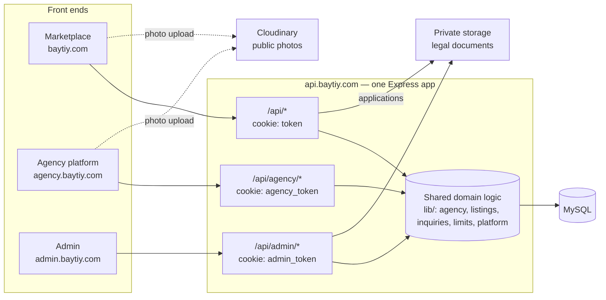
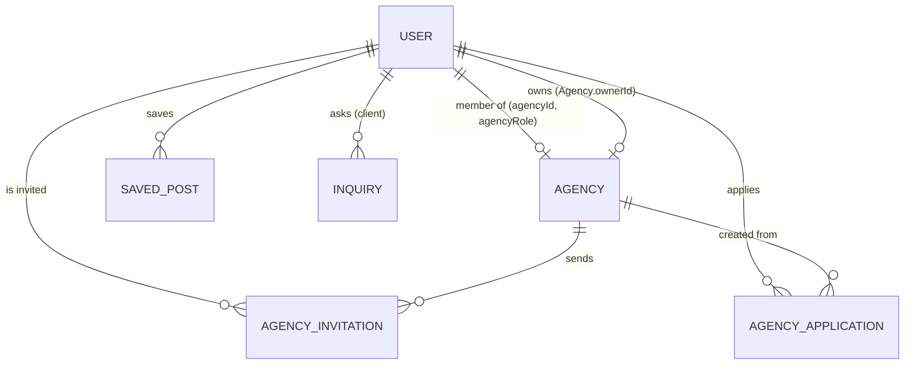
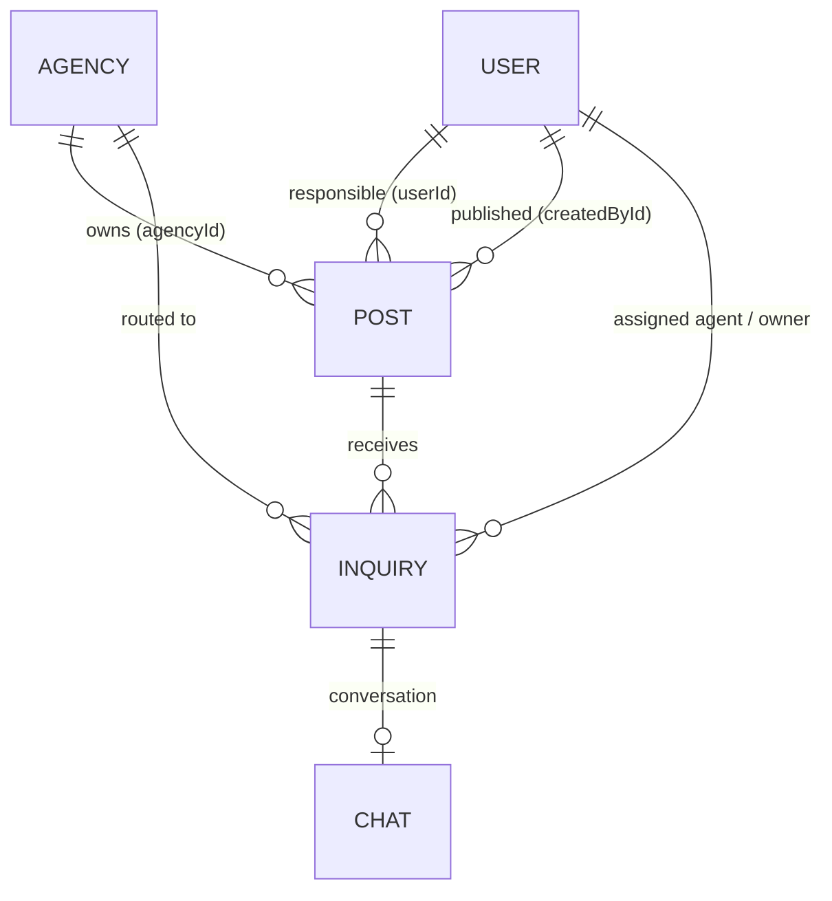
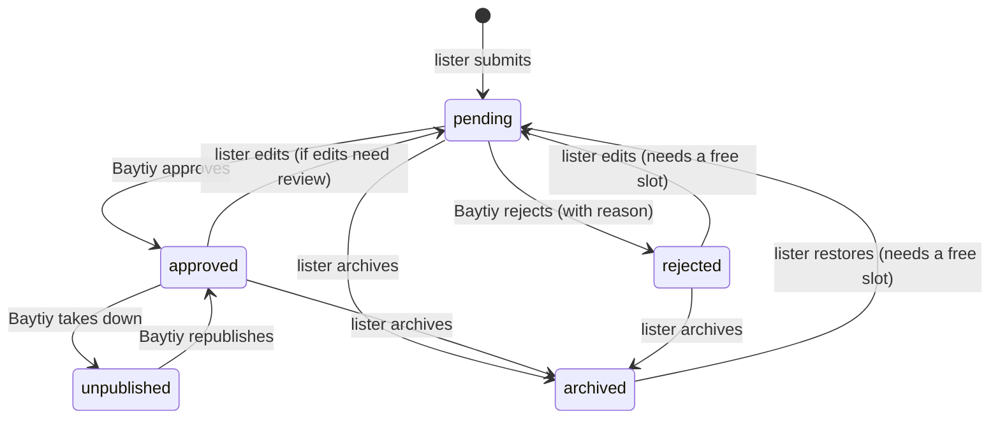
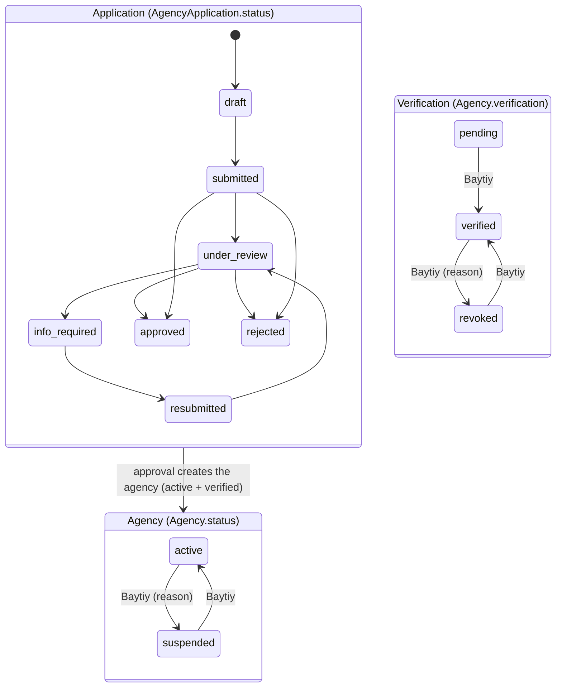
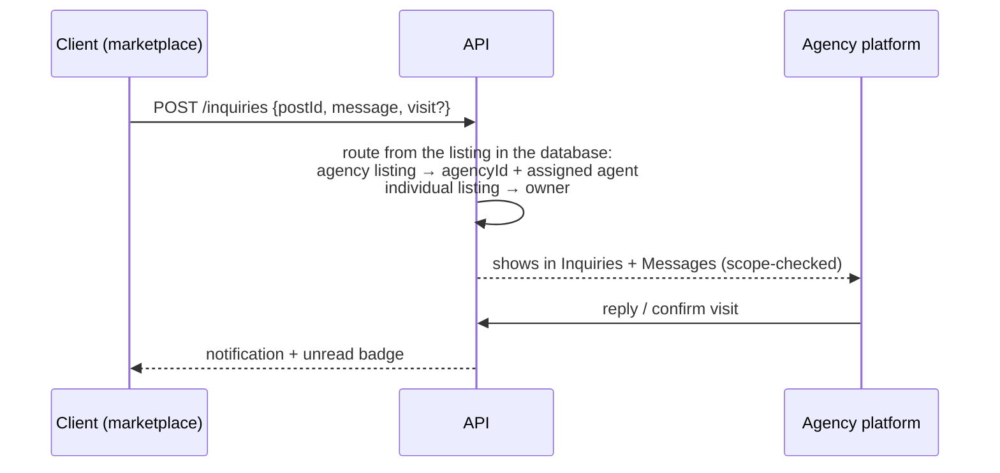

# Baytiy architecture

Audit of the whole platform (October 2026), the target model, and the changes made to reach it.

Baytiy is one product with three front ends and one backend:

| App | Domain | Who | Code |
|---|---|---|---|
| Marketplace | baytiy.com | Visitors, buyers, renters, individual owners. Agency staff can also use it as private individuals | `client/` |
| Agency platform | agency.baytiy.com | Members of an agency: owner, managers, agents | `agency/` |
| Admin | admin.baytiy.com | The Baytiy team only | `admin/` |
| API | api.baytiy.com | Shared Express + Prisma backend for all three apps | `api/` |
| Database | MySQL / MariaDB | Single source of truth | `api/prisma/schema.prisma` |

---

## 1. Audit findings

Severity: **Critical** = security hole or data loss. **High** = wrong business behaviour or a model that will keep producing bugs. **Medium** = inconsistency or fragility. **Low** = clean-up.

### Critical

| # | Finding | Where | Consequence |
|---|---|---|---|
| C1 | An agency could add **any** existing account to its team just by typing its email. The person was not asked. | `agencyTeam.addTeamMember` | Any agency owner could take over a stranger's account: the stranger lost marketplace access immediately, and any of their open listings became agency listings. |
| C2 | Agency listings were owned through the agent who created them (`Post.userId`). If the agent left and nobody could take the listings, they **left the agency and became the agent's personal listings**. | `lib/agency.detachMember` | The agency loses its property, and a former employee walks away with it. This contradicts "the agency keeps ownership". |
| C3 | Deleting an agent's account deleted **every listing they had ever created**, including the agency's listings. | `user.controller.deleteUserCascade` | An admin action on one person silently erased agency inventory. |
| C4 | Conversations belonged to the individual agent, not the agency. A departing agent kept the client conversations and the agency lost them. Any signed-in user could also open a chat with any account ID. | `chat.controller.addChat` | Leak of client data to ex-employees, no handover, and a spam/harassment vector. |
| C5 | Listing descriptions, chat messages and visit-request messages were `VARCHAR(191)`, and MariaDB runs in non-strict mode. | `schema.prisma` + server `sql_mode` | Text longer than 191 characters was **silently truncated** on save. Data loss for every long description. |
| C6 | Marketplace listing creation and edits copied fields from the request without validation: photo links, numbers, types. | `post.controller.addPost/updatePost` | Arbitrary URLs could be injected as photos, and wrong types caused 500s. |
| C7 | Sessions survived a password reset, and cookies had no `secure` flag in production. | `auth.controller`, middlewares | Resetting a stolen password didn't log the attacker out. |

### High

| # | Finding | Consequence |
|---|---|---|
| H1 | `User.role` mixed staff role and agency role (`client / agent / agency / admin`), duplicating `agencyRole`. It was kept in sync by hand in 6 places. | The two drifted, and code checked one or the other at random. |
| H2 | Agency verification was a plain boolean. There was no "revoked" state, no reason, and the owner's `User.verified` was a copy of it. | "Unverified" and "revoked for fraud" looked the same, with no history. |
| H4 | Visit requests (`TourRequest`) were addressed to a **person**. The column called `agencyId` actually held a user ID. They were separate from chat and had no link to the agency. | Inquiries got lost when listings moved between agents, and the agency could not see them as a whole. |
| H5 | Agency profile data was duplicated on the owner's `User` row (`agencyName`, `location`, `website`, `about`) and synced in two directions. The owner's marketplace profile edit could rename the agency without review. | Two sources of truth, and a bypass of the legal-change review. |
| H6 | Listings marked sold or rented still counted towards the 3-listing limit and stayed in search. | Stale results, and owners had to delete sold properties to publish new ones. |
| H7 | The old in-marketplace agency dashboard (`client/src/routes/agencyDashboard`) still called the removed `/tours/agency` API. | Dead code that could be revived by accident. |

### Medium / Low

- **M1:** Login throttling and request de-duplication are kept in process memory. This is fine on one server but doesn't work across serverless instances; use Redis or a database table when scaling.
- **M2:** Admin promotion (`PUT /admin/users/:id/role`) is a single click by any admin. It is audited, but there is no second-admin approval (see §9).
- **M3:** Photos are uploaded straight from the browser to Cloudinary with an **unsigned preset**, so anyone who reads the preset name can upload to the account. Legal documents are correctly kept off Cloudinary, in private storage streamed through authorised endpoints.
- **L1:** `Post.price` is an `Int` (max ≈ 2.1 billion DZD). That is enough today; move to `BigInt` before luxury or commercial listings need it.
- **L2:** `images` is a JSON array rather than a `PropertyImage` table. Acceptable until photos need ordering, captions or moderation.
- **L3:** Latitude and longitude are stored as strings.

### What is already right, and stays

- **Separate sessions per platform:** separate cookies, secrets and audiences, with the role re-read from the database on every request.
- **Agency application lifecycle:** draft → submitted → under review → info required → resubmitted → approved / rejected. It comes with an event history, internal notes and private documents.
- **Computed verified badge:** never stored on listings.
- **Concurrency-safe listing limit:** a row lock plus a count inside one transaction.
- **Moderation and audit trail:** a moderation queue, admin audit log, agency activity log and reports.
- **Agency role permissions:** a per-role permission matrix, enforced on the server.

---

## 2. Target model

### 2.1 Identity: one person, one account

- **`User` is the person.** It holds credentials, profile, contact details and account status (`active / suspended / deactivated`).
- **`User.role` is the staff role only:** `client` (everyone) or `admin` (the Baytiy team). Buying, renting and publishing are **capabilities**, not account types.
- **Agency membership** is `User.agencyId + agencyRole (owner|manager|agent) + agencyActive`. One person belongs to at most one agency at a time. That is a business rule, so a column enforces it, and membership history lives in the audit log.
  - A separate `AgencyMembership` table would only add joins until multi-agency membership is actually needed. It can be extracted later without changing the API.
- **Joining an agency needs the person's consent.** An `AgencyInvitation` must be accepted. The exception is an account the agency creates for a brand-new employee, which starts with no history.
- **Registering an agency opens an agency account** (`User.accountType = agency`) on the agency platform, never a marketplace account. Until Bayti approves the application, that account can only sign in to follow and edit its application (`/api/agency/application`); every other agency route answers 403. On approval the same account becomes the agency's owner and its open session upgrades to the full workspace.
- **The team can complete an application**: an admin edits any field and files documents the agency sent by email or brought in person (`PUT /admin/applications/:id`, `POST /admin/applications/:id/documents`). Each change appears in the application's history, which the applicant sees, and in the audit log.
- **Agency accounts live on the agency platform only.** Owners, managers and agents can't sign in to the marketplace and have nothing to do there: every action they take happens in the agency workspace. Accepting an invitation ends the person's marketplace session and sends them to the agency sign-in. Someone who leaves an agency becomes an ordinary marketplace account again.
- **Admins are staff-only accounts.**
  - They can't join or own agencies, and can't sign in to the marketplace or the agency platform.
  - Only an existing admin can grant the role, and the action is audited.
  - The first admin is bootstrapped from the server (`npm run make-admin`).

| Capability | Who has it |
|---|---|
| Browse, search, view | Everyone, signed in or not |
| Save favourites, send inquiries, request visits, track them | Marketplace accounts (not agency members, not staff) |
| Publish personal listings (3 active) | Marketplace accounts. Agency members publish through their agency. |
| Agency workspace | Active members with `agencyActive = true` |
| Admin dashboard | `role = admin` |

### 2.2 Platform access

| Account | Marketplace | Agency platform | Admin |
|---|---|---|---|
| Individual | ✔ | ✖ "This is the agency platform" → marketplace login | ✖ |
| Agency member (owner, manager, agent) | ✖ "This isn't the agency platform" → agency login | ✔ | ✖ |
| Agency account in review (applicant) | ✖ → agency login | Its application only | ✖ |
| Agency member switched off by the agency | ✖ | ✖ | ✖ |
| Admin | ✖ → admin login | ✖ → admin login | ✔ |
| Suspended / deactivated | ✖ | ✖ | ✖ |

> Agency members are refused at the marketplace login and no marketplace session is opened. A marketplace session opened before someone joined an agency stops working on the next request. The marketplace offers agency staff no account features; the only agency entry points are "Become an agency", "Agency sign-in", and, for a browser that already holds an agency session, a link back to the dashboard.

### 2.3 Agency, agent and property

Every listing answers four questions:

| Question | Field | Rule |
|---|---|---|
| Who **owns** it? | `agencyId` set → the agency. Otherwise → `userId`. | Never changes silently. Only an admin moves a listing between owners. |
| Who **published** it? | `createdById` | Set at creation and never changed, so the history survives reassignments and departures. |
| Who is **responsible** day to day? | `userId` | For an individual listing, the owner (always set). For an agency listing, the assigned agent, or **empty = unassigned** (handled by the owner and managers). |
| Is it public? | see §2.4 | |

### Scenarios

| # | Scenario | What happens |
|---|---|---|
| 1 | The owner creates a listing | Owned by the agency, published by the owner, assigned to the owner or any active member they choose. |
| 2 | A manager creates one | The same, and a manager may assign it to any active member. |
| 3 | An agent creates one | Owned by the agency, published by and assigned to that agent. An agent can't assign it to anyone else. |
| 4 | An agent leaves | Their listings and open inquiries move to the member chosen when they leave, or to the owner. If nobody can take them, they become **unassigned and stay with the agency, unchanged and still published**. The agent keeps no access to the agency's listings or conversations. |
| 5 | The agency removes an employee | Same as 4. |
| 6 | The agency is suspended | All its listings disappear from the marketplace, the badge disappears, and new inquiries are refused. Members can still sign in and read their data but can't change anything. Reactivation restores everything; nothing is deleted. |
| 7 | Verification is revoked | The agency stays active and its listings stay published, but the **verified badge disappears everywhere at once**, because it is computed. The reason is recorded and the owner is notified. |
| 8 | An individual hands a property to an agency | An admin changes the listing's owner from the admin dashboard, which is audited. The listing goes back to review under the agency. A self-service request-and-accept flow is the next step (see §8). |
| 9 | Reassigning to another agent | Owner or manager: `PUT /agency/listings/:id/assign`. The listing's open inquiries follow it, and the change is audited. |
| — | An agent's account is deleted | Their agency listings become unassigned. Nothing the agency owns is deleted. |
| — | The owner's account is deleted | The agency is suspended until an admin hands it to a new owner. Its listings are kept. |

### 2.4 Property lifecycle

Four independent concepts, each in its own field:

| Concept | Field | Values |
|---|---|---|
| Moderation and lifecycle | `status` | `pending` (in review) → `approved` / `rejected`; `unpublished` (taken down by Baytiy); `archived` (withdrawn by the lister) |
| Lister's pause | `hiddenByOwner` | temporarily offline without losing approval |
| Transaction | `availability` | `available`, `under_offer`, `sold`, `rented` |
| Promotion (future paid) | `featured` | set by Baytiy only |

**Public** means all of the following:
- `status = approved`, and `hiddenByOwner = false`.
- `availability` is not `sold` or `rented`. A closed listing leaves search but its page still opens, marked sold or rented.
- The owner is live: for an individual listing the account is active; for an agency listing the agency is active.

**Active**, which is what the limit counts, means `status ∈ {pending, approved}` and `availability ∉ {sold, rented}`. Drafts don't exist yet; a draft would simply be a status outside that set.

Who can change what:

| Action | Lister | Agency (by role) | Baytiy |
|---|---|---|---|
| Create, edit | Individual owner | Owner/manager: any; agent: their own | ✔ |
| Archive / restore, pause | ✔ | Owner/manager: any; agent: their own | ✔ |
| Mark sold / rented | ✔ | ✔ | ✔ |
| Approve, reject, take down, feature | ✖ | ✖ | ✔ |
| Change the owner | ✖ | ✖ | ✔ |
| Delete | ✔ (inquiries are kept) | Owner/manager: any; agent: their own | ✔ |

### 2.5 Listing limits

- **Configurable, not hard-coded.**
  - Individuals: `settings.listings.individualActiveLimit` (3).
  - Agencies: `settings.agencies.activeListingLimit` (0 = unlimited).
  - `limitFor(owner)` is the single place a future subscription plan plugs into.
- **Enforced on the server under a row lock** (`withActiveSlot`):
  - when publishing, restoring, or resubmitting a rejected listing;
  - when an admin moves a sold or rented listing back to available.
- **Admin-created listings are exempt.**

### 2.6 Agency application and verification

Three separate concepts:

- **Badge = `status = active` AND `verification = verified` AND agrément not expired.**
  - It is computed on every request by `isAgencyVerified()`.
  - It is never stored on a listing, and never accepted from a client.
- **History is kept:**
  - Every application step is an `ApplicationEvent`.
  - Every suspension, reactivation, verification and revocation is an `AuditLog` row with its reason.
  - The agency itself keeps the current reason in `statusReason` / `verificationNote`.

### 2.7 Inquiries

A single `Inquiry` covers questions and visit requests from a client about one property. It replaces `TourRequest`, and the existing rows were migrated.

| Field | Meaning |
|---|---|
| `clientId` | The interested person. |
| `postId` | The property. Kept as null if the listing is deleted, so the history survives. |
| `agencyId` | Set for agency listings: the agency owns the inquiry. |
| `ownerId` | Set for individual listings: the owner answers. |
| `assignedToId` | The agent responsible. It follows the listing's assignment, and is empty when unassigned. |
| `type` | `question` or `visit`. |
| `status` | `open`, `scheduled` (visit confirmed), `closed`, `declined`, `cancelled` (by the client). |
| `message`, `contactPhone`, `preferredDate/Time`, `confirmedDate/Time`, `declineReason` | Details. |
| `chatId` | The conversation (existing chat tables). |

- **One inquiry per client and property** (unique key). Asking again reopens the same thread, so there are no duplicates.
- **Routing comes from the listing in the database.** A client never says where an inquiry goes.

| Case | Who sees it |
|---|---|
| Individual listing | The owner, in the marketplace inbox. |
| Agency listing | Owner and managers (whole agency), plus the assigned agent. |
| Assigned agent leaves | Reassigned with their listings, or unassigned; the leads always see it. The agent loses access. |
| Agency suspended | The agency can read but not reply. New inquiries are refused because the listing is no longer public. |
| Client | Tracks status and conversation under Profile → Inquiries. |
| Baytiy | Read-only oversight in the admin dashboard, through reports. Moderators don't read private conversations by default. |

Conversations are no longer started with an arbitrary account. They always hang off an inquiry. Old person-to-person chats stay readable for the two participants.

---

## 3. Permissions matrix (server-enforced)

| Action | Visitor | Individual | Agent | Manager | Agency owner | Admin |
|---|---|---|---|---|---|---|
| Browse, view agencies | ✔ | ✔ | ✔ | ✔ | ✔ | ✔ (admin app) |
| Favourites, inquiries | ✖ | ✔ | ✖ | ✖ | ✖ | ✖ |
| Personal listings (limit) | ✖ | ✔ own | ✖ | ✖ | ✖ | ✔ any |
| Agency listings | ✖ | ✖ | own/assigned | all in agency | all in agency | ✔ any |
| Assign listings | ✖ | ✖ | ✖ | ✔ | ✔ | ✔ |
| Agency inquiries | ✖ | ✖ | assigned | all in agency | all in agency | oversight |
| Invite / manage agents | ✖ | ✖ | ✖ | agents (setting) | ✔ | ✔ |
| Change member roles | ✖ | ✖ | ✖ | ✖ | ✔ | ✔ |
| Edit agency profile | ✖ | ✖ | ✖ | ✖ | ✔ (legal changes reported) | ✔ |
| Approve listings, agencies; verify, suspend | ✖ | ✖ | ✖ | ✖ | ✖ | ✔ |
| Grant admin | ✖ | ✖ | ✖ | ✖ | ✖ | ✔ (audited) |

Agencies are isolated by `agencyId` from the session's database record, on every query: `listingScope`, `inquiryScope`, `loadMember`. Another agency's IDs return 404, never 403, so they can't be probed.

## 4. Data ownership

| Data | Owner (source of truth) | Written by | Read by |
|---|---|---|---|
| Account, credentials, profile | User | Marketplace (self), Admin | All three |
| Agency profile (public) | Agency | Agency owner, Admin | Marketplace (computed badge), Admin |
| Agency legal data and documents | Agency / Application | Applicant, Agency owner (reported), Admin | Admin, Agency owner; never public |
| Verification, status | Agency | **Admin only** | Everyone, computed |
| Membership, roles | User (agency columns), Invitation | Agency owner/manager (with consent), Admin | Agency, Admin |
| Individual listings | Post (`agencyId` null) | Owner, Admin | Marketplace (if public) |
| Agency listings | Post (`agencyId`) | Agency members by role, Admin | Marketplace (if public), Agency |
| Moderation status | Post.status | **Admin only**, plus lister archive/restore | All |
| Inquiries and conversations | Inquiry + Chat | Client, responsible side | Client, agency scope / owner |
| Favourites | SavedPost | User | User |
| Reports | Report | Anyone, Admin | Admin |
| Settings and limits | Setting | Admin | API |

## 5. Security review

| Area | State after this work |
|---|---|
| Authentication | Separate cookies, secrets and audiences per platform. httpOnly, `secure` and `sameSite=lax` in production. Sessions are invalidated by a password change or reset (`passwordChangedAt`). |
| Password recovery | Single-use hashed tokens, 1 h expiry, uniform answers, per-email throttle. |
| Authorisation | Every route re-reads the user and role from the database. Frontend guards are cosmetic only. |
| Agency isolation | Scope helpers on every query; agency IDs come from the session, never from request bodies. |
| Invitations | Consent required, single-use, expiring, revocable. Cannot pull in an admin or another agency's member. |
| Listings | Validated payloads: types, numbers, `https` photo links. Owners can't set status, owner or featured. |
| Legal documents | Private disk storage under random names, file type checked by content, streamed only to the applicant (their own application) or admins. Never on Cloudinary. |
| Photos | Cloudinary, public. **To do before launch:** switch to signed uploads (an API endpoint signs with `CLOUDINARY_API_SECRET`) and restrict accepted photo hosts to your Cloudinary domain. |
| Admin provisioning | Granted only by an existing admin, audited; admins can't join agencies. Recommended: two-admin approval and 2FA for the admin app. |

## 6. Business notes

- **Duplicates and fakes:**
  - Moderation queue before publication.
  - The duplicate finder in admin.
  - Reports.
  - Agrément expiry automatically removes the badge.
- **Employee turnover:** inventory and client threads belong to the agency (scenarios 4 and 5).
- **Expired listings:** add `expiresAt` and a nightly job when listings need renewal. The "active" definition already has a place for it.
- **Monetisation, prepared but not built:**
  - Plans plug into `limitFor()`.
  - Promotion uses `featured` (later a `Promotion` table with dates).
  - Agency packages would attach to `Agency`.
- **Languages and currency:**
  - Strings are in the front ends. Move them to i18n catalogues (ar / fr / en) before translation, and design for right-to-left text in Arabic.
  - Prices are whole DZD.
  - Locations are free text today (`city` = wilaya). A `Wilaya` / `Commune` reference table would stop spelling variants from breaking search.

## 7. Migration plan

1. **Backup:** `node api/backups/backup.mjs` dumps every table to JSON before any migration.
2. **Migration `20261031190000_ownership_inquiries`** is additive first, then copies data. All of it runs in one migration:
   - `Post.createdById` is filled from `userId`. `Post.userId` becomes nullable.
   - `Agency.verification` is filled from `verified`, plus `verificationNote`.
   - `User.passwordChangedAt`.
   - `User.role` values `agent` and `agency` become `client`. Membership is unchanged, because it lives in `agencyId` / `agencyRole`.
   - New `Inquiry` table, filled from `TourRequest`, then `TourRequest` is dropped. Every row is preserved in `Inquiry` and in the backup.
   - New `AgencyInvitation` table.
   - Text columns (descriptions, messages, notes) widened to `TEXT`.
3. **Breaking API changes:**
   - `/api/tours/*` is replaced by `/api/inquiries/*`.
   - `POST /api/chats {receiverId}` is replaced by inquiries.
   - `/api/users/agency` is replaced by `/api/agencies`.
   - All three front ends were updated in the same change.

## 8. Not done yet (next steps)

- Signed Cloudinary uploads and a photo host allow-list (needs your Cloudinary API secret).
- A self-service request for an individual to hand a property to an agency, with acceptance on both sides (admin-mediated today).
- Listing expiry and renewal.
- `Wilaya` / `Commune` reference data; i18n.
- Shared rate limiting (Redis or a database table) once the API runs on several instances.
- 2FA for admin accounts.
- Dropping the deprecated agency columns on `User` (`agencyName`, `location`, `website`, `about`). They are no longer read or written, and are kept until you confirm nothing else uses them.
